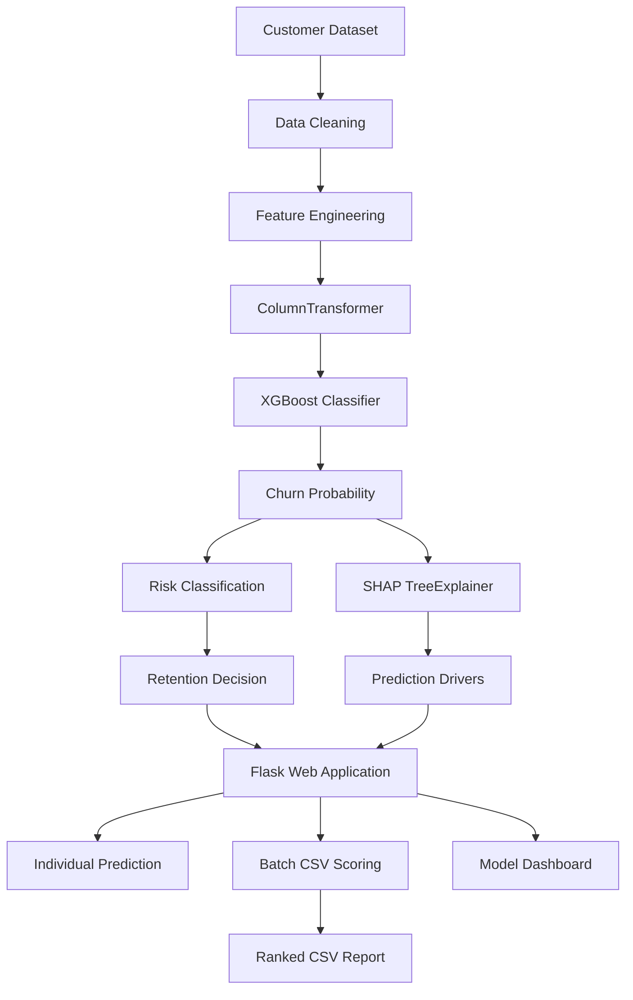

# ChurnGuard
### Customer Churn Prediction & Retention Intelligence

<p align="center">
  An Explainable, Profit-Optimized Machine Learning Application for Identifying At-Risk Customers and Supporting Data-Driven Retention Decisions.
</p>

<p align="center">
  <a href="https://churnguard-churn-prediction-web-app.onrender.com/"><strong>🚀 Live Demo</strong></a> ·
  <a href="https://github.com/Sneha-ops3124/ChurnGuard-churn-prediction-web-app"><strong>📂 GitHub Repository</strong></a>
</p>

<p align="center">
  
  
  
  
  
  
  
</p>

---

## Overview

**ChurnGuard is an end-to-end Customer Churn Prediction and Retention Intelligence platform that transforms customer data into explainable predictions and actionable retention decisions.**

Customer churn is more than a classification problem. For subscription-based businesses, identifying customers who are likely to leave is only valuable when those predictions can support effective retention strategies.

ChurnGuard addresses this challenge through a machine learning pipeline built around XGBoost, leakage-safe preprocessing, SHAP-based explainability, and business-oriented decision threshold optimization.

Instead of relying solely on prediction accuracy, the application uses an optimized decision threshold selected through cross-validation to maximize simulated retention profit.

The platform brings together three essential capabilities:

- **Predict:** Estimate the probability of an individual customer churning.
- **Explain:** Identify the customer attributes contributing most to the prediction.
- **Act:** Prioritize at-risk customers through retention-oriented recommendations.

The result is an interactive, deployable machine learning application that connects predictive modeling with practical business decision-making.

## Live Application

<p align="center">
  <a href="https://churnguard-churn-prediction-web-app.onrender.com/">
    
  </a>
</p>

**Live Demo:** https://churnguard-churn-prediction-web-app.onrender.com/

The deployed application provides individual customer analysis, batch CSV scoring, and a model performance dashboard.

---

## Core Capabilities

### 1. Individual Customer Churn Prediction

Analyze customer information and estimate the probability of churn through an interactive web interface.

The application accepts customer attributes covering:

- Demographics and household information
- Internet and phone services
- Additional subscribed services
- Contract and payment methods
- Customer tenure
- Monthly and total charges

**Prediction outputs:**
- Churn probability expressed as a percentage
- Low, Medium, or High risk classification
- Comparison against the optimized decision threshold
- Top three SHAP-based prediction drivers
- Retention action recommendation

The interface also includes high-risk and low-risk sample profiles for exploring the prediction workflow.

### 2. Explainable AI — SHAP Integration

ChurnGuard integrates SHAP (SHapley Additive exPlanations) to make model predictions interpretable.

Rather than presenting a probability without context, the application identifies the features that contribute most strongly to an individual prediction.

**Local Explainability**
- Identifies the three most influential features for each customer.
- Displays positive and negative feature contributions.
- Helps understand the factors associated with increased or decreased predicted churn risk.

**Global Explainability**
- Provides a SHAP summary visualization.
- Highlights important features across the customer population.
- Helps identify broader patterns associated with customer churn.

SHAP TreeExplainer is used with the deployed XGBoost classifier.

### 3. Profit-Optimized Retention Decisions

A central design principle of ChurnGuard is that the best classification threshold is not necessarily 0.50.

The application uses an optimized decision threshold selected through out-of-fold cross-validation to maximize simulated retention profit.

This shifts the objective from simply maximizing classification accuracy towards identifying customers whose retention decisions may provide greater business value.

The application translates the predicted probability into:

| Risk Level | Interpretation |
|---|---|
| Low | Predicted churn probability is below half the decision threshold |
| Medium | Probability is between half the threshold and the threshold |
| High | Probability meets or exceeds the optimized threshold |

**Retention actions:**
- Customers meeting the optimized threshold are flagged for a retention offer.
- Other customers are assigned no immediate retention action.

### 4. Batch Customer Scoring

ChurnGuard supports bulk customer analysis through CSV uploads.

Users can process multiple customer records without entering each profile individually.

**Workflow:**
1. Upload a customer CSV file.
2. Process customer records through the same feature engineering and prediction pipeline.
3. Calculate churn probabilities.
4. Generate retention actions using the optimized threshold.
5. Rank customers by predicted churn probability.
6. Download the resulting CSV report.

The generated report contains:

| Column | Description |
|---|---|
| `customerID` | Customer identifier |
| `churn_probability` | Predicted churn probability |
| `action` | Recommended retention action |

Customers are sorted in descending order of predicted churn probability, allowing businesses to prioritize their retention efforts.

### 5. Model Performance Dashboard

The dedicated model dashboard provides transparency into model selection, evaluation, and explainability.

**Dashboard highlights:**
- Deployed XGBoost model identification
- Optimized decision threshold
- Leakage-safe validation methodology
- Comparison of evaluated machine learning models
- Precision, Recall, and F1-score
- ROC-AUC and PR-AUC
- Simulated retention profit on the held-out test set
- Global SHAP feature importance visualization

The dashboard presents model evaluation results alongside business-oriented performance indicators.

---

## Machine Learning Architecture

ChurnGuard follows a structured machine learning workflow designed to maintain consistency between model development and production inference.

### 1. Data Preparation

The application works with customer subscription and billing information based on the Telco Customer Churn dataset.

The preprocessing workflow includes:

- Data cleaning and type conversion.
- Handling missing or invalid `TotalCharges` values.
- Separation of numerical and categorical features.
- Removal of customer identifiers and target labels from training features.

### 2. Feature Engineering

Two additional features are engineered to capture customer service adoption and spending behavior.

| Engineered Feature | Calculation |
|---|---|
| `num_addons` | Number of subscribed internet add-on services |
| `avg_monthly_spend` | TotalCharges / max(tenure, 1) |

The tenure divisor is clipped to a minimum of one to handle newly registered customers.

### 3. Preprocessing Pipeline

A Scikit-learn `ColumnTransformer` handles numerical and categorical transformations.

| Feature Type | Transformation |
|---|---|
| Numerical | StandardScaler |
| Categorical | OneHotEncoder |
| Unseen Categories | `handle_unknown="ignore"` |

The preprocessing operations are integrated into the machine learning pipeline, ensuring that training and inference use consistent transformations.

### 4. Model Development and Evaluation

The project uses XGBoost as its deployed classification model.

The evaluation methodology includes:

- Stratified 5-fold cross-validation.
- Leakage-safe preprocessing.
- Out-of-fold decision threshold optimization.
- Evaluation on a separate held-out test set.
- Comparison using imbalanced classification metrics.
- Simulated retention profit evaluation.

### 5. Explainability

SHAP TreeExplainer interprets the deployed XGBoost classifier.

The transformed features are used to calculate individual feature contributions, while the global SHAP summary plot provides an overview of feature importance across customers.

### 6. Production Inference

The trained preprocessing and classification pipeline is serialized using Joblib.

At application startup, the Flask backend loads:

- The trained model pipeline.
- The optimized decision threshold.
- Stored model evaluation metrics.

The same feature engineering and prediction workflow is reused for individual and batch customer scoring.

---

## System Architecture



---

## Technology Stack

| Layer | Technologies |
|---|---|
| Programming Language | Python |
| Backend Framework | Flask |
| Frontend | HTML, CSS, JavaScript |
| Machine Learning | XGBoost, Scikit-learn |
| Data Processing | Pandas, NumPy |
| Explainable AI | SHAP |
| Model Serialization | Joblib |
| Visualization | Matplotlib |
| Testing | Pytest |
| Deployment | Render |
| Production Server | Gunicorn |

---

## Project Structure

```text
ChurnGuard-churn-prediction-web-app/
│
├── data/
│   └── raw/
│
├── models/
│   ├── churn_model.pkl
│   └── threshold.json
│
├── reports/
│   └── metrics.json
│
├── src/
│   └── features.py
│
├── static/
│   ├── app.js
│   ├── style.css
│   └── shap_summary.png
│
├── templates/
│   ├── index.html
│   └── dashboard.html
│
├── app.py
├── requirements.txt
├── LICENSE
└── README.md
```

---

## Getting Started

Follow the instructions below to run ChurnGuard locally.

### Prerequisites

- Python 3.x
- pip
- Git

### 1. Clone the Repository

```bash
git clone https://github.com/Sneha-ops3124/ChurnGuard-churn-prediction-web-app.git
```

### 2. Navigate to the Project

```bash
cd ChurnGuard-churn-prediction-web-app
```

### 3. Create a Virtual Environment

```bash
python -m venv venv
```

Activate the environment:

**Windows**

```bash
venv\Scripts\activate
```

**macOS / Linux**

```bash
source venv/bin/activate
```

### 4. Install Dependencies

```bash
python -m pip install --upgrade pip
pip install -r requirements.txt
```

### 5. Start the Application

```bash
python app.py
```

### 6. Access the Application

Open your browser and navigate to:

```text
http://127.0.0.1:5000/
```

**Important:** The application expects the trained model, optimized threshold, and evaluation metrics to be available in the `models/` and `reports/` directories.

---

## Application API

The Flask application exposes the following routes:

| HTTP Method | Endpoint | Functionality |
|---|---|---|
| GET | `/` | Renders the customer prediction interface |
| POST | `/predict` | Predicts individual customer churn and returns SHAP drivers |
| POST | `/batch` | Processes customer CSV files and returns a downloadable scoring report |
| GET | `/dashboard` | Displays model comparison and global explainability |

### Prediction Response

The `/predict` endpoint returns a JSON response containing the predicted probability, risk category, decision threshold, retention flag, and top feature drivers.

Example response:

```json
{
  "probability": 0.823,
  "flagged": true,
  "threshold": 0.5,
  "risk": "High",
  "drivers": [
    {
      "feature": "tenure",
      "impact": 0.35
    },
    {
      "feature": "Contract",
      "impact": 0.22
    },
    {
      "feature": "MonthlyCharges",
      "impact": 0.14
    }
  ]
}
```

*Illustrative example only. Actual values are generated dynamically by the trained model.*

---

## Model Evaluation

ChurnGuard evaluates classification performance using multiple metrics rather than relying exclusively on accuracy.

| Metric | What It Measures |
|---|---|
| Precision | Reliability of positive churn predictions |
| Recall | Ability to identify actual churn cases |
| F1-score | Balance between precision and recall |
| ROC-AUC | Overall class discrimination |
| PR-AUC | Precision-recall performance |
| Simulated Profit | Estimated business value of retention decisions |

The dashboard loads evaluation results from `reports/metrics.json`, allowing model comparisons to be presented directly in the application.

---

## Deployment

ChurnGuard is deployed on **Render**.

The production application uses Flask for request handling and Gunicorn as its WSGI server.

**Production URL:**

https://churnguard-churn-prediction-web-app.onrender.com/

---

## Future Enhancements

Potential areas for further development include:

- Integration with live CRM and customer databases.
- Automated retention campaign management.
- Customer segmentation based on behavioral patterns.
- Historical churn trend monitoring.
- Automated model retraining and evaluation.
- Retention budget allocation and revenue impact analysis.
- User authentication and role-based access control.

---

## License

This project is licensed under the MIT License. See the [LICENSE](LICENSE) file for details.

---

## Author

**Sneha Sharma**

GitHub: [@Sneha-ops3124](https://github.com/Sneha-ops3124)

---

<p align="center">
  <strong>ChurnGuard</strong>
  <br/>
  Predict Risk. Explain Behavior. Optimize Retention.
</p>
